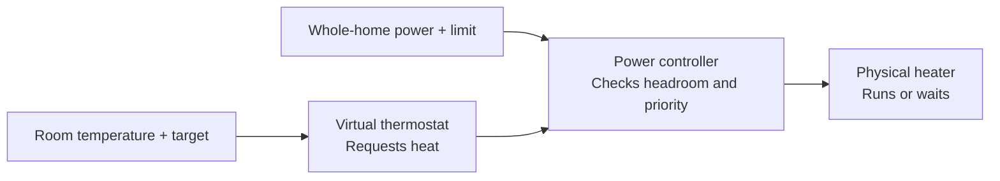

<div align="center">
  <picture>
    <source media="(prefers-color-scheme: dark)" srcset="custom_components/power_heating_controller/brand/dark_logo.png">
    
  </picture>
</div>

# Power Heating Controller for Home Assistant

Coordinate electric heating across rooms using your home's live power reading and a shared power limit. Each room gets a virtual thermostat. When several rooms need heat, the controller decides which heaters can run based on available power and room priority.

[](https://my.home-assistant.io/redirect/marketplace_repository/?owner=martin05mlg&repository=Home-Assistant-Power-Heating-Controller&category=integration)

[How it works](#how-it-works) · [Installation](#installation) · [Room setup](#room-setup) · [Dashboard example](#dashboard-example)

## How it works



1. **A room requests heat.** With a 21 °C target and the default tolerances, it starts requesting heat at 20.9 °C and stops at 21.1 °C. The cold and hot tolerances are configurable.
2. **The controller allocates power.** It subtracts measured household consumption and 30-second reservations for newly started heaters from the configured limit. It considers priority first (1 is highest, 10 lowest), then how far below target each room is.
3. **The heater runs or the room waits.** If a room needs 1,000 W and a 4,500 W limit leaves only 900 W available, it normally waits. A higher-priority room can take over from a lower-priority room that has already heated for at least two minutes. With equal priority, the waiting room must be at least 1 °C further below its own target.

If measured consumption stays above the limit for five seconds, the controller sheds managed heaters starting with the lowest-priority, least-cold rooms. It waits 20 seconds after shedding before granting new heating permissions. Other appliances can still draw more power than the managed heaters can shed.

If the power sensor becomes unavailable, new heating permissions pause. If a room's temperature sensor stays unavailable for two minutes, the controller stops heating that room. The controller also periodically checks that heaters match their expected state.

## Installation

### Marketplace · Home Assistant 2026.11 or newer

1. Use the **My Home Assistant** button above and confirm your instance. You can also go to **Settings → Marketplace → Add from link** and paste the [GitHub repository URL](https://github.com/martin05mlg/Home-Assistant-Power-Heating-Controller).
2. Connect GitHub if prompted. Select **Integration** if Marketplace asks for the repository type.
3. Open the repository and select **Install**. Follow any restart prompt in Home Assistant.

Home Assistant migrates installations and custom repositories from HACS when updating to 2026.11. [Home Assistant Marketplace documentation](https://www.home-assistant.io/integrations/marketplace/#coming-from-hacs)

<details>
<summary>HACS · Home Assistant 2025.2 through 2026.10</summary>

1. In HACS, open the three-dot menu and select **Custom repositories**. Add `https://github.com/martin05mlg/Home-Assistant-Power-Heating-Controller` as an **Integration**.
2. Download **Power Heating Controller** and restart Home Assistant.

</details>

<details>
<summary>Manual installation</summary>

Copy the entire `custom_components/power_heating_controller/` directory to `<config>/custom_components/` in your Home Assistant instance, then restart.

</details>

## Room setup

[](https://my.home-assistant.io/redirect/config_flow_start/?domain=power_heating_controller)

After installing, use the setup button or go to **Settings → Devices & services → Add integration → Power Heating Controller**. Setup is available in English and Spanish.

| Configure | What to provide |
| --- | --- |
| Whole home | An instantaneous power sensor in W or kW and the power limit in W. You can also adjust the cold and hot tolerances. |
| Each room | A room name, a temperature sensor reporting in °C, and a physical heater controlled by a `switch` or `climate` entity. |
| Heating preferences | The heater's rated power in W, the room target temperature, and its priority from 1 to 10. |

For a `climate` heater, pick a heating mode from the dropdown. It lists the modes the device reports that can be used for heating, such as **Heat**, **Heat and cool**, or **Automatic**. If a new heater reports no heating modes, check that it is available in Home Assistant or choose another entity. When an existing heater temporarily provides no mode data, the editor can keep its saved heating mode.

The optional maximum-temperature setting is enabled by default. When a room gets permission, the controller selects the heating mode and then asks the heater to use its own maximum setpoint. The virtual thermostat determines when to stop heating the room.

Open **Settings → Devices & services → Power Heating Controller → Configure** to change the power limit, add a room or edit an existing room. If you replace a `climate` heater, choose a mode for the new device in the next step. For either heater type, Home Assistant must confirm that the previous heater reports `off` before the controller saves the replacement. If shutdown fails, the original heater stays assigned to the room.

To remove a room, open it under **Configure**, select **Delete this room**, and confirm with **Remove room** on the next screen. Home Assistant must confirm that the heater reports `off` before removing the room. If it cannot confirm the shutdown within five seconds, the room stays configured and an error is shown.

## Entities and automations

| Location | Entity | Use |
| --- | --- | --- |
| Room | Virtual thermostat (`climate`) | Set the target temperature. Select `heat` to enable the room or `off` to disable it. |
| Room | Heating status (`sensor`) | See whether the room is `heating`, `waiting` for power, `idle`, or `disabled`. |
| Room | Waiting reason (`sensor`) | Distinguishes insufficient power, a missing sensor reading, a power-limit breach, and a pause after shedding load. |
| Controller | Available power and current consumption (`sensor`) | See the remaining power budget and measured consumption in W. |
| Controller | Maximum power limit (`number`) | Change the power limit in W. |

The target temperatures, room enable settings, and power limit are saved across restarts. Entity IDs are assigned by Home Assistant and can be renamed.

<details>
<summary>Actions for automations</summary>

All actions use the `power_heating_controller` domain.

| Action | Use |
| --- | --- |
| `set_max_power` | Set the power limit in W. |
| `set_room_target_temp` | Update a room's setpoint. |
| `enable_room` / `disable_room` | Enable a room or disable it and turn off its heater. |
| `add_room` / `remove_room` | Add or remove a room from the controller. |

Find the `room_id` in the virtual thermostat's state attributes.

</details>

## Dashboard example

In dashboard edit mode, select **Add card → Manual** and paste the YAML below. Replace the example IDs with the IDs from **Settings → Devices & services → Power Heating Controller**. Use the room's virtual thermostat for `climate.office`. Duplicate the two room cards for each additional room. The example uses [built-in Home Assistant cards and controls](https://www.home-assistant.io/dashboards/features/).

```yaml
type: vertical-stack
cards:
  - type: entities
    title: Home power
    show_header_toggle: false
    entities:
      - entity: sensor.power_heating_controller_current_power_consumption
        name: Current consumption
      - entity: number.power_heating_controller_max_power_limit
        name: Power limit
      - entity: sensor.power_heating_controller_available_power
        name: Available power
  - type: tile
    entity: climate.office
    name: Office
    features:
      - type: target-temperature
      - type: climate-hvac-modes
        hvac_modes:
          - heat
          - "off"
  - type: entities
    show_header_toggle: false
    entities:
      - entity: sensor.office_heating_status
        name: Heating status
      - entity: sensor.office_waiting_reason
        name: Waiting reason
```

## Development

The [integration tests](tests/test_integration.py) run in the official Home Assistant containers for 2025.2.0 and 2026.11.2 in GitHub Actions. They exercise room removal and replacement with simulated devices, including shutdown failures, and check that the controller starts the load-shedding timer on the first reading above the limit.

From a local checkout, run the suite with Docker. Replace the image tag to test the other Home Assistant version. On Windows, use a local checkout or copy `custom_components/` and `tests/` to a local directory before binding it if Docker cannot mount a network drive.

```sh
docker run --rm --network none \
  --mount "type=bind,source=$PWD,target=/repo,readonly" \
  --entrypoint python ghcr.io/home-assistant/home-assistant:2026.11.2 \
  /repo/tests/test_integration.py -v
```

The power-burst test sends 120 readings to a controller with four idle rooms and 15 entities. It measured **1,800 → 240 calls to write entity state** on Home Assistant 2026.11.2, a reduction of 87% in this scenario. Both power sensors still publish every reading in the test.

## Changelog

### 2.1.1

- Provides a distinct update for installations that already reported 2.1.0 from the default branch before the first GitHub release. This update includes confirmed heater shutdown before replacement and fewer redundant entity state writes.

### 2.1.0

- Choose a heating mode from the modes reported by the selected heater. When replacing a heater, the controller confirms that the old device is off before saving.
- The options menu is available in English and Spanish.
- Each room has a **Waiting reason** sensor that explains why heating is paused.
- Removing a room from **Configure** requires confirmation. Both **Configure** and the `remove_room` action keep the room if Home Assistant cannot confirm that the heater is off.
- Entities skip redundant state writes during power updates. Added integration tests and a sample dashboard.

### Earlier versions

- **2.0.1** updates the climate and device registry APIs, fixes loading on Home Assistant 2025.2, and adds local branding for Home Assistant 2026.3 and newer.
- **2.0.0** added power reservations, load shedding and heater reconciliation, and improved room priorities, sensor outage handling and settings persistence. [Changes in 2.0.0](https://github.com/martin05mlg/Home-Assistant-Power-Heating-Controller/commit/663d643)
- **1.1.0** fixed options editing, service registration and entity registry cleanup.

## License

[MIT](LICENSE)
